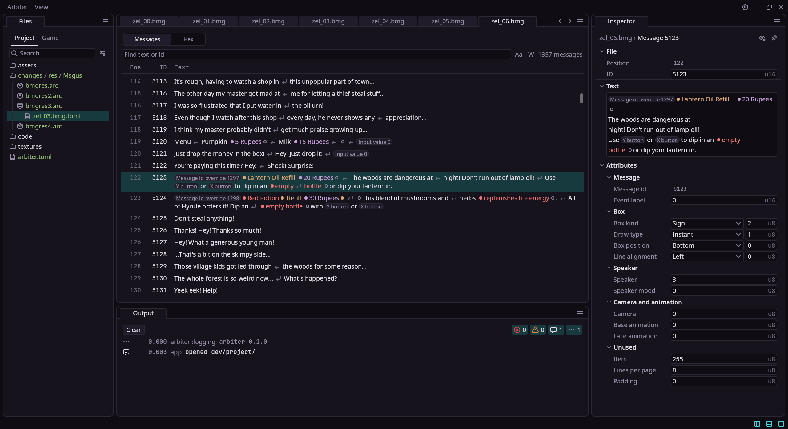

# Arbiter

Arbiter is an editor for viewing, editing, and building mods for Twilight Princess (GameCube).

> [!IMPORTANT]
> Arbiter is discontinued. It can partially view and edit message text (bmg files), but building mods remains unfinished.

---

## Why?
Existing tools for Nintendo's games are few and far between, and most were built for a single use-case.
Because of this, many features are missing and compatibility is not guaranteed.

Format converters are also flawed because they treat game files in isolation. They don't understand
game-specifics or interact with the game itself.

Arbiter's goal was to unify these tools under one roof, and to understand how formats fit together as a whole.

## What works
- An IDE-inspired workspace for viewing and interfacing with game files via dockable panels
- A custom GUI engine built on `wgpu`, handling windowing, input, layout and drawing
- Unpacking GameCube discs into a project
- Reading RARC archives and Yaz0 compression
- Viewing BMG message files, with tags shown as chips, and finding messages
- Editing message text, ids and attributes with undo and redo
- Saving edits as patches over the base game files, and reopening them

## What doesn't
- Building a disc or mod, so edits can't be tested in the game yet
- Message flow graphs, and adding or removing messages
- Any format beyond messages and archives, such as models and textures

## Why it stopped
Format support works on paper, but explaining what a format means requires teaching modders how each game
works, what was built for it, and how its data moves around.

My answer was "game-tables", which held translations and logic per game. These proved to be unreasonably hard
to verify and maintain, as every game uses libraries differently, and those libraries interact in different
ways. I only realized this when I started implementing game-tables (which is why so much of the project was
already built).

My scope was too far-fetched, and the codebase became unmaintainable. I may salvage Arbiter one day, but
focused tools from other developers may serve each area better - working with the code rather than relying
on best-guess assumptions.

With today's decompilation efforts and AI assistance developers can work out how a game's formats interact for
themselves, and build their tooling custom to their needs, rather than adhering to the game/library restrictions
as I naively attempted to do.

## History
Arbiter was a ground-up rebuild of [TPMT (Twilight Princess Modding Toolkit)](https://github.com/3e2j/TPMT).
See its README for the project's history and why I restarted it.

For the rebuild, I needed a workspace I could fully control, rendered like a game engine. Existing GUI crates
weren't flexible enough, so I built my own, and it works well! But as a greenfield system, it isn't the easiest
framework to work in.

## Credits
Arbiter's interface was heavily inspired by [Godot](https://godotengine.org/) and [Zed](https://zed.dev/),
whose approachable, user-first design shaped much of how Arbiter looks and works.

Twilight Princess definitions and game structures come from the
[Twilight Princess decompilation](https://github.com/zeldaret/tp)
and [Dusklight](https://github.com/TwilitRealm/dusklight).
